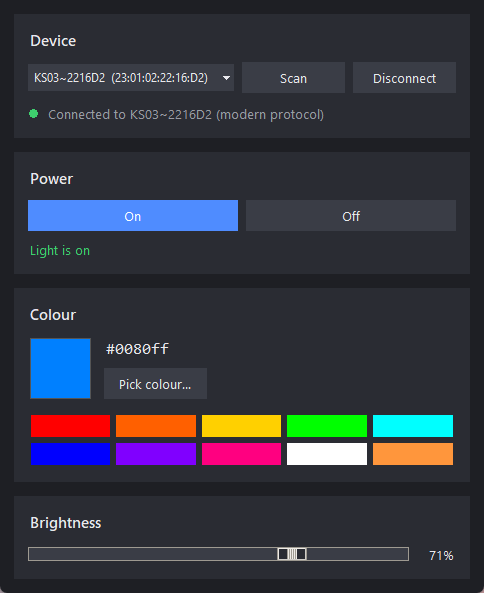

# keepsmile

Control **Keepsmile** Bluetooth LED strips and bulbs from Windows, without the phone app.

The Keepsmile iOS app (`com.KS.KSLights`) talks to its lights over Bluetooth Low Energy using a small, undocumented
byte protocol. This project reverse engineered that protocol from the app and reimplemented it as:

- a **Python library** (`keepsmile`) built on [bleak](https://github.com/hbldh/bleak),
- a **command-line tool** (`python -m keepsmile on`),
- a **desktop GUI** (`python -m keepsmile.gui`).

It supports power on/off, colour and brightness, and reads the light's current state back when it connects.



## Supported devices

Anything the Keepsmile app shows as a light whose Bluetooth name starts with `KS`. The protocol is picked from the
name, exactly like the app does it:

| Bluetooth name   | Example        | Protocol |
| ---------------- | -------------- | -------- |
| `KS03-…`, `KS04-…` | older strips and bulbs | legacy (`7E … EF` frames) |
| `KS03~…` and everything else | newer strips (e.g. the app's "Strip light") | modern (`5A`/`5B` frames) |

Tested on a `KS03~` strip on Windows 11. The legacy protocol is implemented from the app's code but hasn't been
tested against real hardware.

## Requirements

- Windows 10/11 with Bluetooth LE (bleak also supports macOS and Linux, but only Windows has been tested)
- Python 3.10 or newer (tkinter is included with the standard Windows installer)

```powershell
git clone https://github.com/jake-378/keepsmile.git
cd keepsmile
pip install -r requirements.txt
```

**Close the Keepsmile phone app (or turn off the phone's Bluetooth) first.** These lights only accept one connection
at a time, so if the phone is connected the PC won't find the light.

## GUI

```powershell
python -m keepsmile.gui
```

On startup it scans for lights, picks the nearest `KS03` strip and connects. From there you can:

- turn the light on and off,
- choose any colour with the colour picker or one of the presets,
- drag the brightness slider (changes are sent live, at most every 100 ms like the phone app).

The window shows the light's real power state, colour and brightness, read from the light when it connects. If the
connection drops, the status turns red and you can press **Connect** to reconnect.

## Command line

```powershell
python -m keepsmile scan                 # list nearby lights
python -m keepsmile on
python -m keepsmile off
python -m keepsmile color ff8000         # hex RRGGBB ...
python -m keepsmile color 255,128,0      # ... or r,g,b
python -m keepsmile brightness 60        # 0-100
```

Options (put them before the command):

| Option | Meaning |
| ------ | ------- |
| `--address 23:01:02:22:16:D2` | use a specific light instead of the nearest `KS03` strip |
| `--protocol legacy\|modern` | override the protocol detected from the name |
| `--timeout 5` | scan timeout in seconds |

The modern protocol sends colour and brightness in the same packet, so to change one the other has to be sent again.
The CLI and GUI remember each light's last colour and brightness in `~/.keepsmile.json`. That way
`brightness 60` doesn't reset the colour to white.

## Library

```python
import asyncio
from keepsmile import KeepsmileLight, scan

async def main():
    lights = await scan(timeout=5)          # FoundLight objects, nearest first (.name .address .rssi .protocol)
    found = lights[0]

    async with KeepsmileLight(found.device, found.name) as light:
        print(light.is_on, light.rgb, light.brightness)   # state read from the light
        await light.turn_on()
        await light.set_color(255, 0, 128)
        await light.set_brightness(40)
        await light.turn_off()

asyncio.run(main())
```

`KeepsmileLight` also accepts:

- `on_state(LightState)`, called whenever the light reports its state,
- `on_disconnect()`, called when the connection is lost.

`connect()` retries automatically, and `write()` reconnects once if Windows has dropped the link.

To build packets without Bluetooth, use `keepsmile.protocol`:

```python
from keepsmile import protocol
protocol.color(protocol.Protocol.MODERN, 255, 0, 0, brightness=50).hex(" ")   # '5a 00 01 ff 00 00 00 32 00 a5'
```

## Protocol

Everything below was recovered from the iOS app, version 2.3.5. `RR GG BB` are 0–255 and `LL` is brightness 0–100.

### Bluetooth services

The app looks for one of three GATT services and writes commands to the matching characteristic:

| Service | Write | Notify |
| ------- | ----- | ------ |
| `FFF0` | `FFF3` | `FFF3` |
| `AE00` | `AE01` | `AE02` |
| `AFD0` | `AFD1` | `AFD2` |

The app writes *with response* unless the characteristic only supports write-without-response.

### Connection handshake

The app sends one packet right after connecting. The newer strips **drop the connection about 2 seconds after
connecting** if they don't receive it, so this library sends the same packet:

| Service | Packet | Meaning |
| ------- | ------ | ------- |
| `AE00` / `AFD0` | `5F 01 00 F5` | query state |
| `FFF0` | `7E 07 83 HH MM SS WD FF EF` | set the light's clock (`WD`: 1 = Sunday … 7 = Saturday) |

The query is answered with a notification like `5F 06 01 F0 FF 00 00 00 29 3F 00 F5`:

| Byte | Value | Meaning |
| ---- | ----- | ------- |
| 0–1 | `5F 06` | state report |
| 2 | `01` | mode |
| 3 | `F0` / `0F` | on / off |
| 4–6 | `FF 00 00` | colour (red) |
| 7 | `00` | warm white |
| 8 | `29` | brightness (41) |

### Commands

| Action | Legacy (`KS03-`, `KS04-`) | Modern (`KS03~`, others) |
| ------ | ------------------------- | ------------------------ |
| On | `7E 04 04 F0 01 01 FF 00 EF` | `5B F0 00 B5` |
| Off | `7E 04 04 10 01 00 FF 00 EF` | `5B 0F 00 B5` |
| Colour | `7E 07 05 03 RR GG BB 00 EF` | `5A 00 01 RR GG BB 00 LL 00 A5` |
| Brightness | `7E 04 01 LL FF FF FF 00 EF` | same as colour, with the new `LL` |

## How it was reverse engineered

The short version is below. [`analysis/README.md`](analysis/README.md) has the full write-up and the scripts.

1. **Unpacked the decrypted IPA** and found the main Mach-O binary (an Objective-C app).
2. **Pulled strings** from the binary (`analysis/strings_scan.py`). Names like `SwitchNewLight`,
   `ChangeWithColor`, `ChangeBrightnessWithModel`, `findCharacteristicForPeripheral` and the `KS03-`/`KS04-` prefixes
   pointed straight at the Bluetooth code.
3. **Decompiled it with Ghidra** (headless). Calls in arm64 Objective-C binaries go through `objc_msgSend`
   stubs that Ghidra leaves unnamed. `ResolveStubs.java` maps each stub to the selector it sends, so the decompiled
   code reads `objc_stub::writeValue:forCharacteristic:type:` instead of `FUN_10045a2c0`.
4. **Read the decompiled command builders** (`BluetoothDataTool`, `SendDataHandler`, `BluetoothConnection`,
   `BluetoothManage`) to get the exact bytes for each command, how the protocol is picked from the device name, and
   which services and characteristics are used.
5. **Tested on real hardware** with bleak. The strip kept disconnecting about 2 seconds after connecting, which led
   back to the app's post-connect handshake (state query and clock sync) and the state-report parser.

## Project layout

```
keepsmile/
  protocol.py     packet builders and state parser (no Bluetooth, fully unit-tested)
  client.py       scanning, connecting, handshake, reconnects (bleak)
  state.py        remembers last colour/brightness per light (~/.keepsmile.json)
  __main__.py     command-line tool
  gui.py          tkinter GUI
tests/            pytest tests for the protocol
analysis/         reverse-engineering scripts and notes
docs/             screenshot
```

Run the tests with:

```powershell
pip install pytest
python -m pytest -q
```

## Not included

The decrypted app and anything taken from it (decompiled C, symbol dumps, the Ghidra project) are **not** in this
repository; they're Keepsmile's copyrighted code. The scripts in `analysis/` let you regenerate them from your own copy
of the app.

## Troubleshooting

- **"No Keepsmile lights found"**: close the phone app and move closer. The light accepts only one connection and
  has a short range.
- **Connects, then drops after a couple of seconds**: something else is connecting without the handshake. With this
  library it should stay connected; if not, open an issue with the output of `python -m keepsmile scan`.
- **Takes a long time to connect the first time**: Windows reads all the Bluetooth services the first time. Later
  connections use the cached services and take about a second.

## License

[MIT](LICENSE)

## Disclaimer

This is an independent project and isn't affiliated with or endorsed by Keepsmile. The protocol was worked out for
interoperability with lights you own. Use at your own risk.
